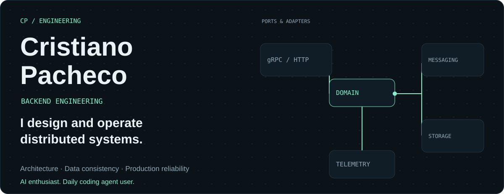
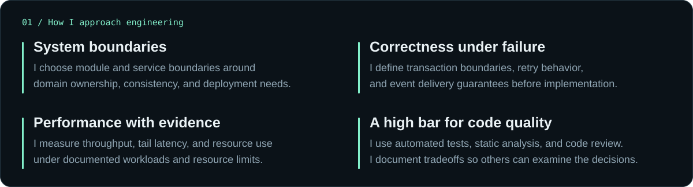
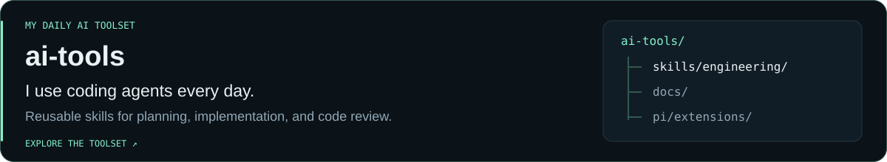
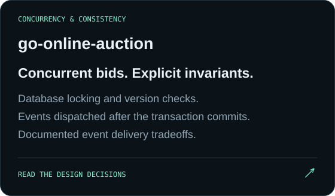
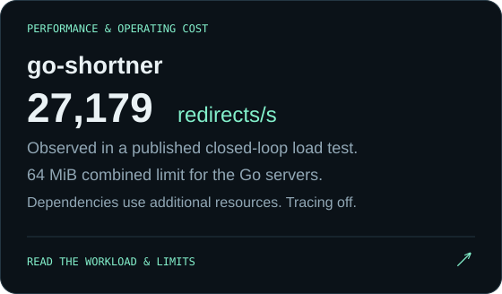
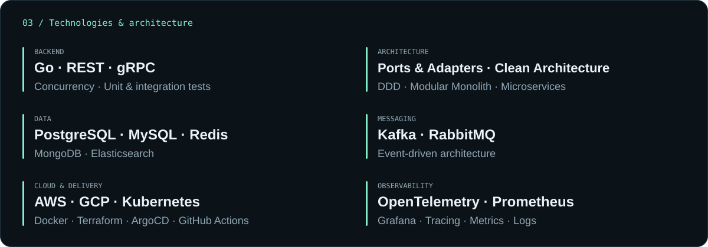

  

  <a href="https://www.linkedin.com/in/cristiano-pacheco/">LinkedIn</a>
  &nbsp; / &nbsp;
  <a href="https://github.com/cristiano-pacheco?tab=repositories">Repositories</a>
  &nbsp; / &nbsp;
  São Paulo, Brazil

I build backends for payments and commerce, where data consistency and failure handling matter. 
I'm an AI enthusiast and a heavy user of coding agents for planning, implementation, testing, and review.

### 02 / Selected work

---

Tech books, side projects, and the occasional Call of Duty match.

